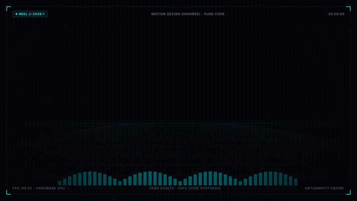

<h3 align="center">
  <br>
  StudyDock<br>
  <sub>Local-First Engineering Tracker & Curriculum Studio</sub>
</h3>

<p align="center">
  <a href="https://nextjs.org"></a>
  <a href="https://www.typescriptlang.org"></a>
  <a href="https://orm.drizzle.team"></a>
  <a href="https://www.postgresql.org"></a>
  <a href="https://vitest.dev"></a>
  <a href="LICENSE"></a>
  
</p>

<p align="center">
  <a href="assets/showreel-motion.mp4">
    
  </a>
</p>
<p align="center">
  <em>15-Second Product Motion Film · <a href="assets/showreel-motion.mp4">Watch High-Res MP4</a> · <a href="public/docs/studydock-architecture.html">Interactive Architecture</a></em>
</p>

**StudyDock** is an open, local-first workbench engineered to track intensive software engineering curricula without cloud lock-in, data leaks, or vanity metrics. Backed by PostgreSQL 16, it pairs daily execution tools (60fps Kanban, focus timer telemetry, DSA problem tracking) with long-horizon curriculum version control.

---

## Key Features

- **⚡ 60fps Kanban Workbench**: Optimistic drag-and-drop task orchestration (*To Do*, *In Progress*, *Done*), slide-over detail drawer, and category filtering (*DSA*, *Architecture*, *Implementation*).
- **⏱️ Focus Session Telemetry**: Integrated digital stopwatch with 1-click recording, manual session audit logs, and weekly target vs. actual hours reconciliation.
- **🧠 DSA Drill Tracker**: Algorithmic problem bank categorized by pattern (Two Pointers, Sliding Window, DP, Graphs), difficulty metrics, and independent solve rate evaluation.
- **🗺️ Curriculum Engine & Gatekeeper**: Multi-phase syllabus progression requiring mandatory exit checkpoint attestations before advancing to subsequent weeks.
- **🔄 Deterministic CSV Sync**: Safe syllabus updates via immutable task IDs (`w01_t01`), formula-injection defense, and non-destructive re-imports.
- **🔒 Zero Telemetry & 100% Offline**: Runs exclusively on `localhost` with persistent Docker volume storage and zero external network dependencies.

---

## Visual Overview

<p align="center">
  <a href="screenshots/01_today_drawer.png"></a>
  <a href="screenshots/02_roadmap.png"></a>
</p>
<p align="center">
  <a href="screenshots/05_dsa.png"></a>
  <a href="screenshots/07_analytics.png"></a>
</p>

---

## Videos & Architecture

- **15s Product Motion Film**: [Watch MP4](assets/showreel-motion.mp4) · [Preview GIF](assets/showreel-motion.gif) · [Interactive HTML](videos/showreel-motion/index.html)
- **Interactive System Architecture**: [Explore Live SVG Diagram](public/docs/studydock-architecture.html) · [Diagram GIF](assets/studydock-architecture.gif)
- **Product Setup Walkthrough**: [Watch MP4](assets/studydock-demo.mp4) · [Setup GIF](assets/studydock-setup-and-demo.gif)
- **Architecture Video Tour**: [Watch MP4](assets/studydock-architecture.mp4)

---

## Quickstart

Requires **Docker** (or Node.js 20+ and pnpm 9+).

### Option A: Complete Docker Compose (Fastest)

```bash
git clone https://github.com/AhmedAbdelHady24/studydock.git
cd studydock
docker compose up --build -d
open http://127.0.0.1:3000
```

### Option B: Local Host Development

```bash
# 1. Start isolated PostgreSQL database
docker compose up -d db

# 2. Install dependencies & initialize database
pnpm install
pnpm db:migrate
pnpm db:seed

# 3. Start development server
pnpm dev
```

Visit [http://127.0.0.1:3000](http://127.0.0.1:3000).

---

## Operational Commands

| Command | Action |
|---|---|
| `pnpm dev` | Start development server on `localhost:3000` |
| `pnpm test` | Run Vitest unit & integration test suite (12/12 passing) |
| `pnpm test:e2e` | Run Playwright end-to-end integration tests |
| `pnpm typecheck` | Run TypeScript strict compiler verification |
| `pnpm db:migrate` | Apply pending Drizzle schema migrations to PostgreSQL |
| `pnpm db:seed` | Ingest initial 33-week syllabus and course targets |
| `pnpm db:backup` | Export atomic timestamped SQL dump to `./backups/` |
| `pnpm db:restore` | Restore database snapshot (`bash scripts/db-restore.sh <file>`) |

---

## Tech Stack

- **Framework**: Next.js 14 (App Router)
- **Language**: TypeScript 5.7 (Strict Mode)
- **Database**: PostgreSQL 16 (Dockerized, persistent volume)
- **ORM**: Drizzle ORM 0.39 (`drizzle-kit`)
- **Styling**: Tailwind CSS, Lucide Icons, Sonner Toasts
- **Testing**: Vitest, Playwright, Fallow Codebase Intelligence

---

## License & Disclaimer

MIT License. See [LICENSE](LICENSE) for details.

StudyDock is an independent, local-first open-source productivity workbench designed for individual self-directed study and deliberate software engineering practice.
