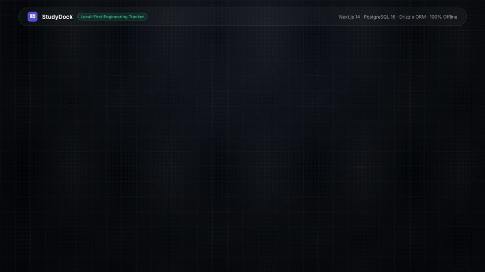
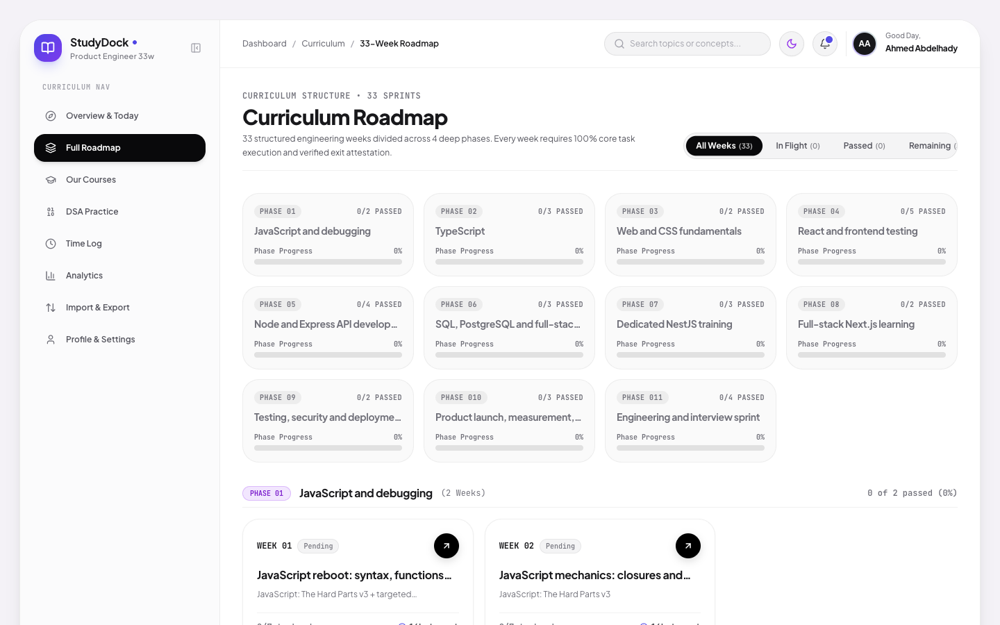
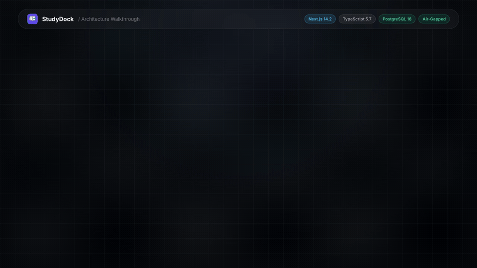
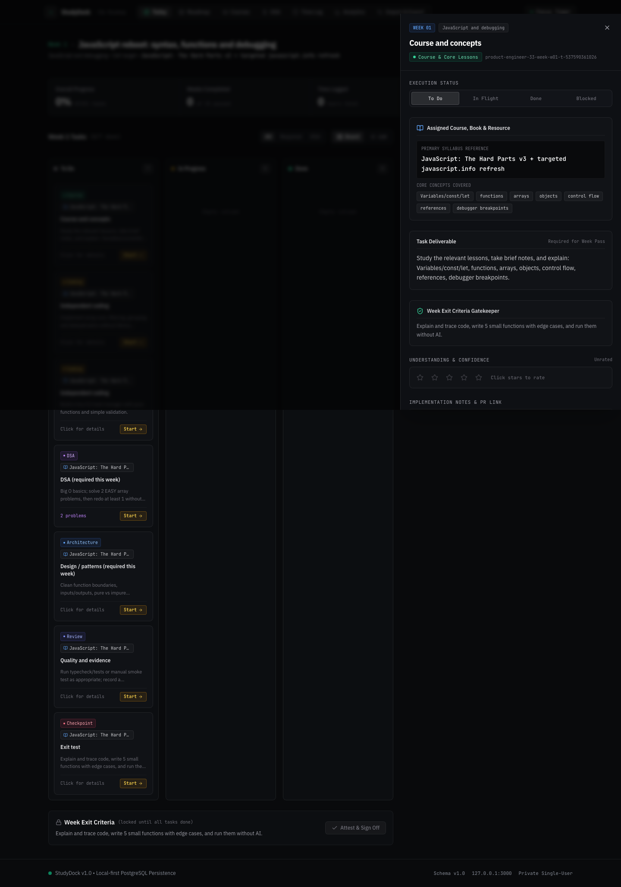
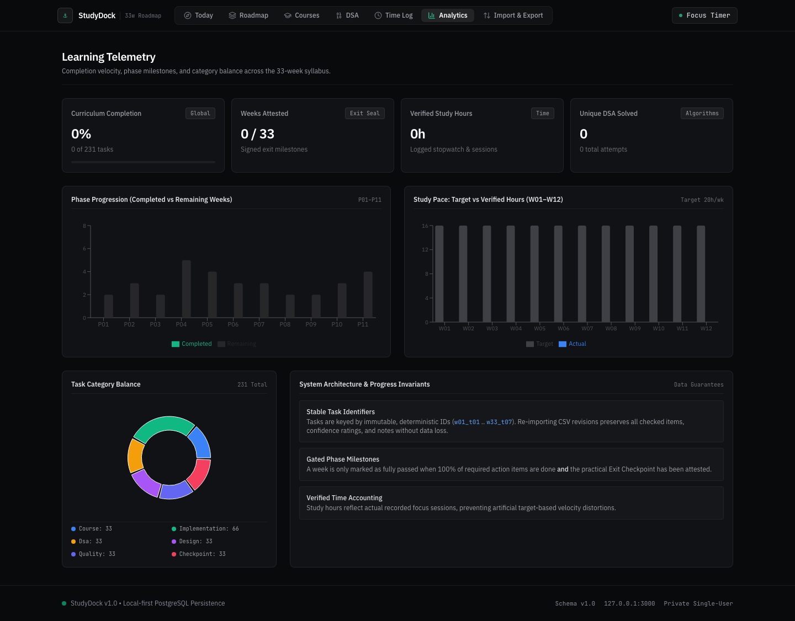
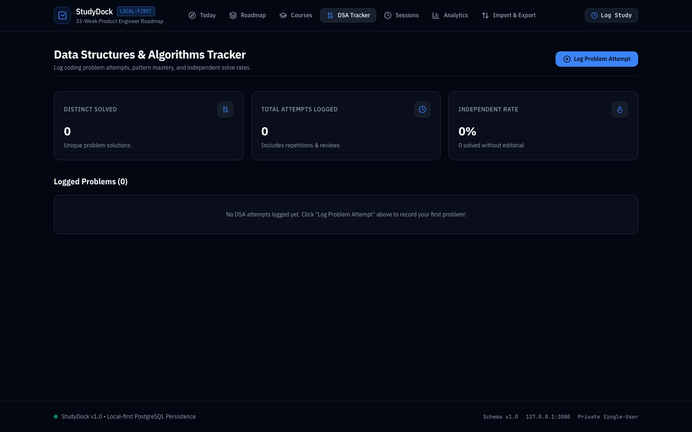
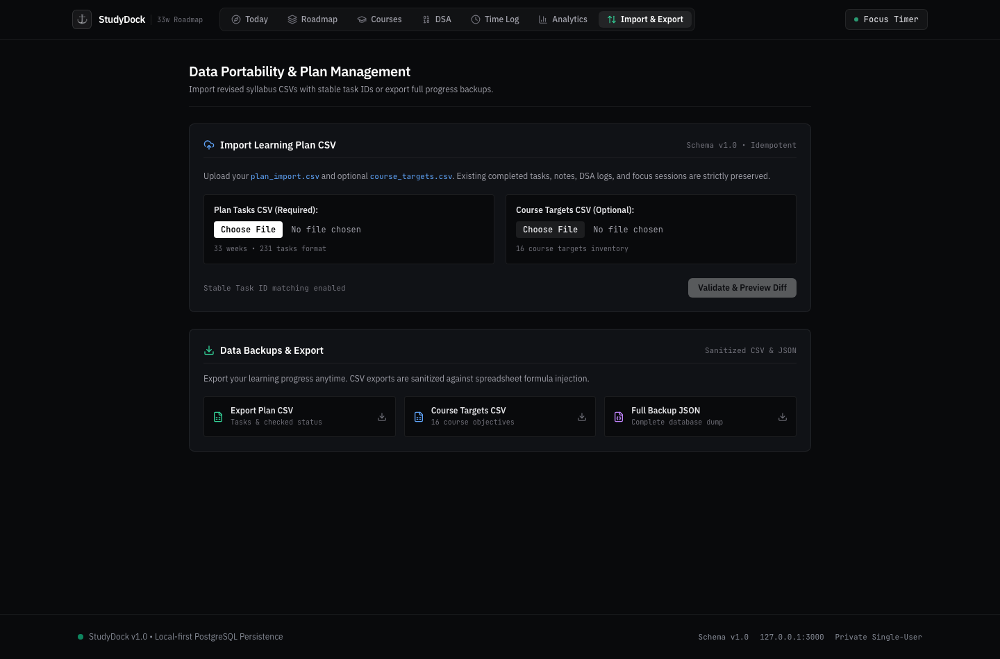
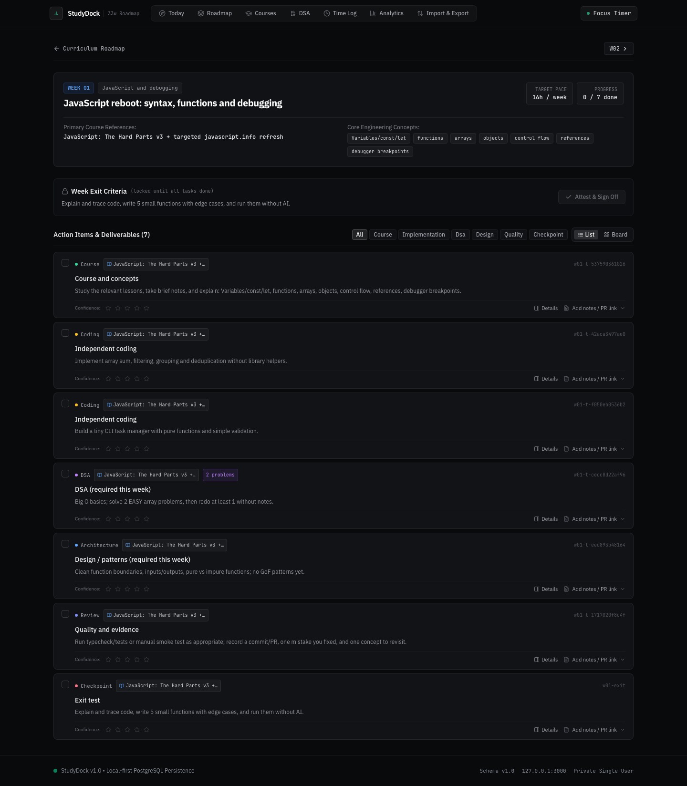

<h3 align="center">
  <br>
  StudyDock<br>
  <sub>Local-First Engineering Tracker & Curriculum Studio</sub>
</h3>

<p align="center">
  <a href="https://nextjs.org"></a>
  <a href="https://www.typescriptlang.org"></a>
  <a href="https://orm.drizzle.team"></a>
  <a href="https://www.postgresql.org"></a>
  <a href="https://vitest.dev"></a>
  <a href="LICENSE"></a>
  
</p>

<p align="center">
  <a href="#install--quickstart">
    
  </a>
</p>

A **learning harness** is the deliberate system around an engineer that converts ambitious study intent into sustained, auditable technical mastery: structured roadmaps, spaced retrieval cadences, honest exit gates, session telemetry, and immutable progress accounting. **StudyDock** is an open, local-first workbench engineered to harness intensive software engineering curricula without cloud lock-in, data leaks, or gamified vanity metrics.

StudyDock couples two interconnected loops while preserving complete ownership of your learning data:

* **Execution-level loop**: Drives daily deliberate practice through a 60fps optimistic Kanban board, an integrated digital focus stopwatch, categorized algorithmic drill tracking (DSA), and mandatory exit checkpoint attestations before advancing.
* **Curriculum-level loop**: Manages long-horizon engineering roadmaps with deterministic CSV diffing, non-destructive re-imports via immutable task IDs (`w01_t01` through `w33_t07`), formula-injection defense, and complete SQL snapshot backups.

<p align="center">
  <a href="screenshots/02_roadmap.png">
    
  </a>
</p>

Across intensive multi-month engineering curricula, StudyDock enforces strict operational invariants: **zero telemetry** outbound calls, **0ms remote lag** via direct local PostgreSQL transactions, **formula-sanitized exports** conforming to OWASP spreadsheet standards, and an **adversarial Break-UI testing harness** ensuring resilient layout integrity against worst-case data.

The system natively supports **Docker Compose and standalone host execution**, **collapsible responsive navigation**, **dark and light themes**, **Sonner toast pipelines**, and **Fallow codebase intelligence**.

## Video overview & architecture

* **Product Motion Film**: [Watch / Download MP4 (15.0s, 1080p Master)](assets/showreel-motion.mp4) · [Preview GIF](assets/showreel-motion.gif)
* **Interactive Architecture Diagram**: [Explore live interactive HTML/SVG diagram](public/docs/studydock-architecture.html)
* **Product Setup & Demo Walkthrough**: [Watch / Download MP4 (10.0s)](assets/studydock-demo.mp4)
* **System Architecture Walkthrough**: [Watch / Download MP4 (9.0s)](assets/studydock-architecture.mp4)

<p align="center">
  <a href="public/docs/studydock-architecture.html">
    
  </a>
</p>
<p align="center"><em>Generated with Archify and HyperFrames · Click diagram to explore interactive nodes and live traces.</em></p>

## Visual overview

<p align="center">
  <a href="screenshots/01_today_drawer.png"></a>
  <a href="screenshots/07_analytics.png"></a>
</p>
<p align="center">
  <a href="screenshots/05_dsa.png"></a>
  <a href="screenshots/08_import.png"></a>
</p>

## Contents

- [Video overview & architecture](#video-overview--architecture)
- [Visual overview](#visual-overview)
- [System components](#system-components)
- [Empirical invariants](#empirical-invariants)
- [Install & quickstart](#install--quickstart)
- [Operational workflow](#operational-workflow)
- [Experiments & adversarial stress-testing](#experiments--adversarial-stress-testing)
- [Local-first privacy & zero telemetry](#local-first-privacy--zero-telemetry)
- [Database schema & persistence](#database-schema--persistence)
- [Design engineering & tactile standards](#design-engineering--tactile-standards)
- [Verification & code quality](#verification--code-quality)
- [Contributing](#contributing)
- [License](#license)
- [Disclaimer](#disclaimer)

## System components

StudyDock exposes eight modular subsystems engineered around the learner: **curriculum engine, workbench & kanban, focus timer telemetry, DSA drill tracker, persistence layer, tactile interaction system, toast notification bus, and the adversarial edge case suite**. They govern roadmap lifecycle, state transitions, time verification, and visual resilience.

<p align="center">
  <a href="screenshots/03_week_detail.png">
    
  </a>
</p>

| Component | Architecture & Purpose | Key Capabilities |
|---|---|---|
| **1. Curriculum Engine** | Multi-phase syllabus parser and milestone coordinator | Dynamic week length parsing, weekly learning objectives, mandatory exit checkpoints, and flexible curriculum templates. |
| **2. Workbench & Kanban** | 60fps task orchestration surface | Drag-and-drop status lanes (*To Do*, *In Progress*, *Done*), slide-over detail drawer, category tags, and optimistic UI transitions. |
| **3. Focus Session Telemetry** | Real-time and retroactive time tracking | Digital stopwatch with 1-click recording, manual session audit logs, target vs. actual hours reconciliation. |
| **4. DSA Drill Tracker** | Deliberate algorithmic practice logger | Pattern tagging (Sliding Window, Two Pointers, DP, Graphs), difficulty metrics, and independent solve rate evaluation. |
| **5. Persistence & Drizzle Schema** | Relational data layer over PostgreSQL 16 | Type-safe migrations (`drizzle-kit`), relational integrity, immutable task keys, and automated SQL snapshot scripts. |
| **6. Tactile Interaction System** | Emil Kowalski & Apple WWDC motion standard | `:active { transform: scale(0.97) }`, `cubic-bezier(0.16, 1, 0.3, 1)` easing curves, zero tap-highlight delays, and mobile-native polish. |
| **7. Toast Notification Bus** | Zero-layout-shift feedback bus via Sonner | Light/dark theme awareness, action confirmations, asynchronous operation status, and non-intrusive error reporting. |
| **8. Adversarial Edge Case Suite** | Verified layout resilience engine | Verified tolerance against adversarial conditions: German compounds, 200-char unbroken URLs, 1-item counts, and 0-item empty states. |

## Empirical invariants

StudyDock enforces four non-negotiable engineering invariants:

1. **Deterministic Progress Preservation**:
   - Re-importing a revised syllabus matches tasks by immutable IDs (`w01_t01` through `w33_t07`).
   - Re-imports **never** overwrite completed checkboxes, confidence ratings, notes, DSA attempt records, or study sessions.
   - Tasks deleted from an upstream file are marked as safely archived (`archived_at = NOW()`), never hard-deleted.
2. **Honest, Un-Gamified Metrics**:
   - A week is only certified as complete when **all active required tasks are done AND the Exit Checkpoint has been attested as passed**.
   - Total study hours derive strictly from authenticated session logs—never from static planned estimations.
3. **Spreadsheet Formula Defense**:
   - All CSV exports sanitize potential command execution and formula prefixes (`=`, `+`, `-`, `@`, `\t`, `\r`) with single-quote escaping to prevent remote code execution or formula injection in Excel, Numbers, and Google Sheets.
4. **Local-First Boundary**:
   - The web server binds strictly to `127.0.0.1:3000`.
   - PostgreSQL binds exclusively to localhost with persistent Docker volume storage (`studydock_postgres_data`).
   - Zero analytics pixels, external web fonts, CDN dependencies, or cloud sync daemons.

## Install & quickstart

Use **macOS, Linux, or WSL2 with Node.js 20+, pnpm 9+, and Docker**.

### Option A: Complete Docker Compose (Fastest)

Launch both the Next.js web application and isolated PostgreSQL database:

```bash
# Clone the repository
git clone https://github.com/your-username/studydock.git
cd studydock

# Build and start all services in detached mode
docker compose up --build -d

# Verify running health
docker compose ps

# Open in browser
open http://127.0.0.1:3000
```

### Option B: Local Host Development (Recommended for Development)

Run the Next.js app natively with hot reloading while keeping PostgreSQL containerized:

```bash
# 1. Start isolated PostgreSQL database container
docker compose up -d db

# 2. Install dependencies
pnpm install

# 3. Apply Drizzle database migrations
pnpm db:migrate

# 4. Seed initial roadmap and course targets
pnpm db:seed

# 5. Start development server
pnpm dev
```

Visit [http://127.0.0.1:3000](http://127.0.0.1:3000).

## Operational workflow

StudyDock provides a unified set of pnpm scripts for development, data integrity, and backup operations:

```bash
# Start development server on http://localhost:3000
pnpm dev

# Execute full Vitest automated test suite (12/12 passing)
pnpm test

# Run Vitest in interactive watch mode
pnpm test:watch

# Execute Playwright end-to-end integration test suite
pnpm test:e2e

# Type-check TypeScript codebase without emitting JS
pnpm typecheck

# Build optimized production bundle
pnpm build

# Run automated Fallow codebase intelligence audit
pnpm run audit
```

### Database & Backup Operations

| Command | Action | Description |
|---|---|---|
| `pnpm db:migrate` | Apply Migrations | Applies pending Drizzle ORM schema migrations against PostgreSQL. |
| `pnpm db:seed` | Ingest Roadmap Seed | Ingests initial 33-week syllabus (`data/import/plan_import.csv`) and course goals. |
| `pnpm db:generate` | Generate SQL DDL | Generates fresh Drizzle migration files from `src/db/schema.ts`. |
| `pnpm db:push` | Direct Push Schema | Synchronizes schema directly with the database in rapid prototyping. |
| `pnpm db:backup` | Timestamped Dump | Exports an atomic SQL snapshot to `./backups/studydock_backup_<timestamp>.sql`. |
| `pnpm db:restore` | Database Snapshot Restore | Restores a selected snapshot (e.g. `bash scripts/db-restore.sh backups/<file>.sql`). |

## Experiments & adversarial stress-testing

StudyDock incorporates an **Adversarial Stress-Testing Methodology** to verify visual resilience under extreme data conditions without corrupting production database tables.

The UI architecture is certified against four deterministic boundary states:

* **Normal**: Standard curriculum data with typical word lengths and card densities.
* **Worst-Case**: Stresses flexbox and CSS grid with German compound nouns (`Donaudampfschifffahrtselektrizitätenhauptbetriebswerkbauunterbeamtengesellschaft`), unbroken 250-character URLs, extreme numeric counts, and Unicode emoji clusters.
* **1-Item**: Verifies that layout containers and Bento statistics do not stretch awkwardly when only a single record exists.
* **0-Items (Empty)**: Verifies that empty state illustrations, instructions, and CTA actions render cleanly without layout collapse.

## Local-first privacy & zero telemetry

StudyDock is intentionally architected to operate **100% offline**:

```
[User Browser]
      │  (HTTP / localhost:3000)
      ▼
[Next.js App Router (Node 20)]
      │  (Connection Pool / localhost:5432)
      ▼
[PostgreSQL 16 Engine] ───► [Persistent Docker Volume: studydock_postgres_data]
      │
      └─── NO OUTBOUND TELEMETRY ───► (Internet Isolated)
```

- **Zero Cloud Leakage**: No telemetry pings, error reporting beacons, or analytics scripts.
- **Self-Contained Fonts & Icons**: Lucide icons are bundled locally; Tailwind relies entirely on system font stacks (`-apple-system`, `BlinkMacSystemFont`, `Segoe UI`, `Inter`).
- **Data Portability**: Full data export available at `/import` in both CSV and JSON formats at any time.

## Database schema & persistence

The relational schema is defined with TypeScript safety in [`src/db/schema.ts`](src/db/schema.ts):

* **`weeks`**: Weekly milestones, phase groupings (Phase 1–4), target study hours, exit checkpoint requirements, and attestation logs.
* **`tasks`**: Granular learning items tied to immutable task IDs (`w01_t01`), categories (*DSA*, *Architecture*, *Independent Coding*, *Course*, *Review*, *Checkpoint*), status (*to_do*, *in_progress*, *done*), confidence ratings (1–5), notes, and evidence URLs.
* **`study_sessions`**: Verified time records with start/end timestamps, duration in seconds, task associations, and qualitative notes.
* **`dsa_attempts`**: Problem-solving logs recording difficulty (*Easy*, *Medium*, *Hard*), algorithmic pattern, independent solve boolean, and review notes.
* **`course_targets`**: Curriculum course definitions with target week intervals and completion progress.

## Design engineering & tactile standards

StudyDock adheres to Emil Kowalski design engineering principles and Apple WWDC fluid interface standards:

* **Tactile Press States**: Interactive elements feature micro-spring active feedback (`:active { transform: scale(0.97); }`).
* **Calibrated Easing**: Motion uses hardware-accelerated cubic-bezier curves (`cubic-bezier(0.16, 1, 0.3, 1)`) with durations capped at 200ms to eliminate perceptible input lag.
* **Mobile-Native Touch**: Touch targets observe `@media (hover: hover)` guards, `-webkit-tap-highlight-color: transparent`, and viewport height stability using `100dvh`.
* **Adaptive Theme Engine**: Synchronized light and dark themes using semantic CSS variables, zero-flash SSR hydration, and subtle semi-transparent border rings.

## Verification & code quality

Every release is validated against automated testing suites and static code intelligence:

```bash
# Run unit & integration test suite
pnpm test

# Output:
# ✓ tests/metrics.test.ts (3 tests)
# ✓ tests/csv-parser.test.ts (7 tests)
# ✓ tests/exporter.test.ts (2 tests)
# Test Files  3 passed (3)
# Tests       12 passed (12)
```

The codebase is audited using **Fallow** (`pnpm run audit`) to eliminate circular dependencies, identify unused exports, and enforce architectural boundary layers between the presentation tier and persistence logic.

## Contributing

See [CONTRIBUTING.md](CONTRIBUTING.md) for local branch workflows, commit message conventions, and testing guidelines.

## License

StudyDock is licensed under the [MIT License](LICENSE).

## Disclaimer

StudyDock is an independent, local-first open-source productivity workbench designed for individual self-directed study and deliberate software engineering practice. It is not affiliated with any third-party bootcamps or educational corporations.
